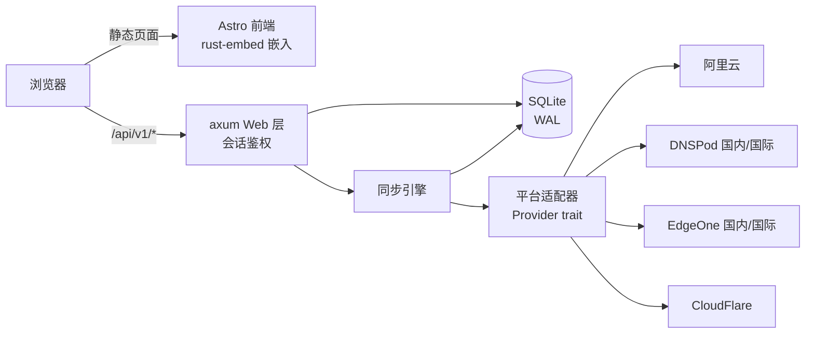

# 架构设计

UniDNS 是单二进制 Rust 应用：axum Web 服务 + SQLite 存储 + Astro 静态前端
（rust-embed 编译期嵌入）。核心分层为 **Web 层 → 同步引擎 → 平台适配器**，
全部状态经 `SharedState`（`Arc<AppState>`）共享。

## 总体结构



## 模块划分（src/）

| 模块 | 职责 |
|---|---|
| `main.rs` | 入口：加载配置、初始化密钥与连接池、启动 HTTP 服务 |
| `config.rs` | 配置加载：默认值 ← 配置文件 ← 环境变量 |
| `crypto.rs` | 凭据 AES-256-GCM 加解密、主密钥管理、管理员口令 Argon2id |
| `db.rs` | SQLite 连接池（WAL + 外键 + 忙等待）与迁移 |
| `models.rs` | 数据行结构（`AccountRow` / `DomainRow` / `RecordRow` 等） |
| `providers/` | 平台适配器：`DnsProvider` trait + 六个实现 + 工厂 |
| `sync.rs` | 同步引擎：账户并发、限流退避、运行记录 |
| `web/` | axum 路由：auth / accounts / records / sync_api + 会话鉴权 |
| `frontend/` | 静态前端服务（rust-embed 嵌入 `frontend/dist`） |
| `error.rs` | 统一错误 `AppError`：到 HTTP 状态码与 `{"error": {code, message}}` 响应体的映射 |

## 平台适配器

所有平台实现统一 trait（`providers/mod.rs`）：

```rust
#[async_trait]
pub trait DnsProvider: Send + Sync {
    async fn verify(&self) -> Result<(), ProviderError>;
    async fn list_domains(&self) -> Result<Vec<ProviderDomain>, ProviderError>;
    async fn list_records(&self, zone: &ProviderZone) -> Result<Vec<ProviderRecord>, ProviderError>;
    async fn create_record(&self, zone: &ProviderZone, input: &RecordInput) -> Result<String, ProviderError>;
    async fn update_record(&self, zone: &ProviderZone, record_id: &str, input: &RecordInput) -> Result<(), ProviderError>;
    async fn delete_record(&self, zone: &ProviderZone, record_id: &str) -> Result<(), ProviderError>;
    async fn set_record_status(&self, zone: &ProviderZone, record_id: &str, enabled: bool) -> Result<(), ProviderError>;
    async fn set_record_remark(&self, zone: &ProviderZone, record_id: &str, remark: &str) -> Result<(), ProviderError>;
    async fn set_domain_remark(&self, zone: &ProviderZone, remark: &str) -> Result<(), ProviderError>;
}
```

- 凭据以 JSON 字符串传入工厂 `build_provider(type, credentials_json, proxy)`，
  由各适配器自行解析；失败返回 `ProviderError::Auth`。
- `ProviderError` 细分 Auth / RateLimited（含 `retry_after`）/ NotFound /
  Unsupported / Network / Api 六类，`error.rs` 据此映射 HTTP 状态码。
- 签名实现各自独立：阿里云 RPC 签名（HMAC-SHA1）、腾讯云系列 TC3-HMAC-SHA256
  （DNSPod 与 EdgeOne 共用）、CloudFlare Bearer Token。

## 同步引擎（sync.rs）

- **并发模型**：`tokio::spawn` 每账户一个任务，`Semaphore(3)` 控制并发上限；
  单账户失败不影响其余，结果聚合为 `Vec<SyncOutcome>`。
- **限流退避**：捕获 `ProviderError::RateLimited` 后按 `retry_after`（上限 60 秒，
  缺省 5 秒）等待并重试一次。
- **运行记录**：每次同步写入 `sync_runs`（状态 / 起止时间 / 错误 / 统计 JSON），
  Web 层可查询历史；同一账户重复触发会被互斥标记拦截（`sync_running`）。
- **可同步开关**：`settings` 表存储域名级同步开关，关闭的域名不参与同步，
  本地备注不回写平台。

## 数据模型（migrations/0001_init.sql）

- `accounts`：平台账户。`provider_type` 受 CHECK 约束（七值枚举，含 `volcengine`），
  `credentials_enc` 为 AES-256-GCM 密文（nonce 前置），`credentials_mask`
  存打码展示串。
- `domains`：同步下来的域名，`UNIQUE(account_id, name)`；`remark` 为本地备注，
  不回写平台。
- `records`：解析记录，含上游 `provider_record_id` 便于回写；
  `pending_sync` 标记待同步变更；`weight`/`priority` 为 EdgeOne 适用字段，
  其他平台为 NULL。
- `settings`：KV 配置（管理员口令哈希、同步开关等）。
- `sync_runs`：同步运行历史。

## 前端（frontend/）

Astro 5 静态站点，构建产物输出到 `frontend/dist`，由 rust-embed 在
`cargo build` 时嵌入二进制。开发时 `astro dev` 将 `/api` 代理到本地 18686，
无需改动后端。

`frontend/public/` 下的品牌与 PWA 资源随构建原样复制到 `dist` 根：

| 文件 | 用途 |
|---|---|
| `icon.svg` | 品牌图标源文件（与登录页 `.brand-mark` 视觉一致） |
| `favicon.png` / `favicon.ico` | 页面 favicon（PNG 为主，ICO 兜底 `/favicon.ico` 隐式请求） |
| `icon-192.png` / `icon-512.png` | Web App Manifest 声明的应用图标 |
| `manifest.webmanifest` | Web App Manifest（名称、图标、主题色、`standalone`） |
| `sw.js` | 静态资源缓存优先的 Service Worker；由 `src/lib/app.js` 在页面加载后注册 |

Service Worker 缓存名为 `unidns-static-v1`，仅缓存同源 GET 且非 `/api/` 的
请求，激活时清理旧版本缓存；修改静态资源时需同步 bump 缓存版本。`/api/`
请求与跨域请求直接走网络，不写入缓存。
